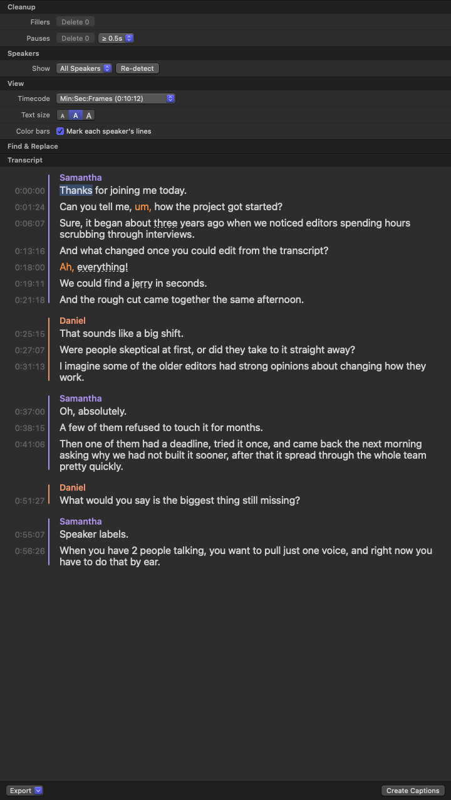

# Transcript Tab for Final Cut Pro

Premiere-style text-based editing inside Final Cut Pro. Transcript Tab adds a fifth tab to the
inspector, next to Video, Audio and Info, where you can read, search and edit with the words
people actually said.

It's a plugin for [SpliceKit](https://github.com/elliotttate/SpliceKit), so it needs a
SpliceKit-patched copy of Final Cut Pro.



## What it does

**Transcripts**
- Uses Final Cut Pro's own transcripts. A clip without one shows a **Transcribe** button that runs
  FCP's built-in transcription (the same as Modify › Analyze and Fix › Transcribe) and saves the
  result in the library.

**Browser clips**
- Click a word to move the browser playhead there.
- Drag across words to mark them as the clip's In and Out, then press E, W, D or Q to append,
  insert, overwrite or connect just that sound bite.

**The timeline**
- Select a clip in the timeline to see the whole timeline's transcript, with trimmed words left out.
- Click a word to jump the playhead; the current word follows playback.
- Drag across words to set the timeline's In and Out around them.
- Select words and press Delete to ripple-delete them from the timeline (Shift-Delete leaves a gap).
- Speech from connected clips appears where the primary storyline has a gap.

**Cleanup**
- Filler words (um, uh, ah…) are highlighted, and one button deletes them all.
- Pauses longer than a threshold you choose are shown and can be deleted in one go, keeping a
  little air on each side.

**Speakers**
- Detect speakers with SpliceKit's built-in speaker detection.
- Speaker names use Final Cut Pro's role color palette, with an optional color bar beside each
  speaker's lines. Hover a name and click the color circle to change it.
- Double-click a name to rename it everywhere; right-click a line to assign it to another speaker.
- Show one speaker at a time.

**Find, fix and export**
- Find & Replace (⌘F), and double-click a word to correct a transcription mistake.
- Export a timecoded transcript (Premiere Pro's layout), plain text, or SRT subtitles.
- Create Captions puts the transcript on the timeline as Final Cut Pro captions, in one undo step.

**View options**
- Timecode style (short, minutes:seconds:frames, project timecode, or hidden), transcript text
  size, color bars, and a darker background. Every section folds away like FCP's own inspectors.

## Requirements

- Final Cut Pro **12.4** patched with **SpliceKit 3.3.9**. Transcript Tab uses Final Cut Pro's
  private classes, so other versions of FCP or SpliceKit may need changes.
- macOS 14 or later, Apple silicon or Intel.

## Install

1. Download `TranscriptTab-1.1.1.zip` from the [Releases](../../releases) page and unzip it.
   You get a folder called `com.innerparakeet.transcript-tab`.
2. Move that folder into SpliceKit's plugins folder:
   `~/Library/Application Support/SpliceKit/plugins/`
   (In Finder: Go › Go to Folder…, paste the path, press Return.)
3. Downloaded plugins are marked as coming from the internet. Clear that mark by running this
   in Terminal:
   ```bash
   xattr -dr com.apple.quarantine ~/Library/Application\ Support/SpliceKit/plugins/com.innerparakeet.transcript-tab
   ```
4. Quit and reopen the SpliceKit-patched Final Cut Pro. Select a clip, then click the new tab in
   the inspector.

If you skipped step 3, macOS shows a "TranscriptTab.dylib Not Opened" prompt when Final Cut Pro
starts. Click **Done** (not Move to Trash), quit Final Cut Pro, run the command from step 3, and
open it again.

### Install from source

```bash
git clone <this repository>
cd fcp-transcript-tab
./install.sh
```

Then restart Final Cut Pro. `./build.sh` on its own builds the release zip into `dist/`.

### Remove

Delete `~/Library/Application Support/SpliceKit/plugins/com.innerparakeet.transcript-tab` and
restart Final Cut Pro.

## Good to know

- **Transcribing writes to your library.** The Transcribe button saves Final Cut Pro's transcript
  into the library, just like Analyze and Fix does. Nothing is transcribed until you click it.
- **Speaker labels, names and word corrections** are saved outside the library, in
  `~/Library/Application Support/SpliceKit/transcript-tab-speakers.json`. Word corrections change
  only the transcript text, never your media.
- **Not yet tested:** multicam and compound clips, retimed clips, and projects that start at a
  timecode other than 00:00:00:00.
- **Speaker detection** works well on clean recordings; on real interviews it sometimes gives the
  interviewer's questions to the main speaker. Right-click a line to fix it.
- **Find** matches inside words ("the" also finds "they").
- A log is written to `/tmp/transcript-tab.log`, which helps when something doesn't work.

## Credits

Built by Inner Parakeet with [Claude Code](https://claude.com/claude-code), on top of
[SpliceKit](https://github.com/elliotttate/SpliceKit) by Elliott Tate.

## License

MIT. See [LICENSE](LICENSE).
