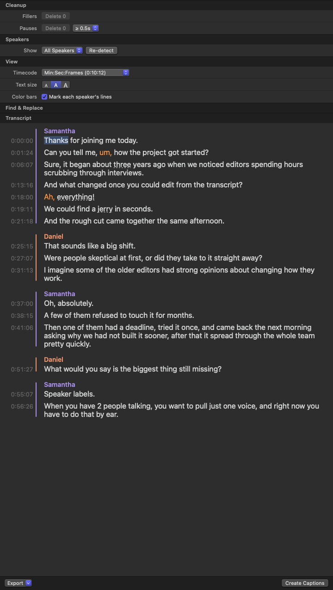

# Transcript Tab for Final Cut Pro

Premiere-style text-based editing inside Final Cut Pro. Transcript Tab adds a fifth tab to the
inspector, next to Video, Audio and Info, where you can read, search and edit with the words
people actually said.

It's a plugin for [SpliceKit](https://github.com/elliotttate/SpliceKit), so it needs a
SpliceKit-patched copy of Final Cut Pro.



## What it does

**Transcripts**
- Shows Final Cut Pro's own transcripts, in any language Final Cut Pro transcribes. A clip without
  one shows a **Transcribe** button that runs FCP's built-in transcription (the same as Modify ›
  Analyze and Fix › Transcribe) in the language you pick, and saves the result in the library.
- For English, **Speakers › Detect** also runs SpliceKit's Parakeet model in the background and lines
  each word up with the audio, so word timing matches what you hear at your cuts: a word you've cut
  off no longer shows, and one you can still hear does. It also puts back the ums and uhs Final Cut
  Pro leaves out, so you can delete them. The text itself stays Final Cut Pro's. Turn the timing off
  in View › Precise word timing.

**Browser clips**
- Click a word to move the browser playhead there.
- Drag across words to mark them as the clip's In and Out, then press E, W, D or Q to append,
  insert, overwrite or connect just that sound bite.

**The timeline**
- Select a clip in the timeline to see the whole timeline's transcript, with trimmed words left out.
- Click a word to jump the playhead; the current word follows playback.
- Drag across words to set the timeline's In and Out around them.
- Select words and press Delete to ripple-delete them from the timeline (Shift-Delete leaves a gap).
- Speech from connected clips appears where the primary storyline has a gap.

**Cleanup**
- Filler words (um, uh, ah…) are highlighted, and one button deletes them all.
- Pauses longer than a threshold you choose are shown and can be deleted in one go, keeping a
  little air on each side.

**Speakers**
- Detect speakers with SpliceKit's built-in speaker detection (about 4 minutes for an 80-minute
  interview; reading audio from FCP's proxy media when it exists is much faster).
- Each speaker gets a color of their own (kept apart from Final Cut Pro's role colors, which mean
  Dialogue, Music and Effects), with an optional color bar beside their lines. Hover a name and
  click the color dot to change it.
- Double-click a name to rename it everywhere; right-click a line to assign it to another speaker.
- Show one speaker at a time.

**Find, fix and export**
- Find & Replace (⌘F), and double-click a word to correct a transcription mistake.
- Export a timecoded transcript (Premiere Pro's layout), a transcript grouped by speaker (one timecode per speaker turn), plain text, or SRT subtitles.
- The **?** button at the bottom left opens the manual.

**View options**
- Timecode style (short, minutes:seconds:frames, project timecode, or hidden), transcript text
  size, color bars, a darker background, and precise word timing. The panel is laid out like Final
  Cut Pro's own inspectors, and every section folds away.

## Requirements

- Final Cut Pro **13.0** patched with **SpliceKit 3.3.9** (1.3.2 was the last release tested on
  FCP 12.4). Transcript Tab uses Final Cut Pro's private classes, so other versions of FCP or
  SpliceKit may need changes.
- macOS 14 or later, Apple silicon or Intel. Speaker detection and precise word timing need Apple
  silicon (SpliceKit's Parakeet tools are Apple silicon only).
- Word alignment uses the small Parakeet CTC model that SpliceKit's speech tools keep in
  `~/Library/Application Support/FluidAudio/Models/parakeet-ctc-110m-coreml`. Without it, Detect
  still works and keeps Parakeet's own (rougher) word times; the log says "no word alignment".

## Install

1. Download `TranscriptTab-1.4.0.zip` from the [Releases](../../releases) page and unzip it.
   You get a folder called `com.innerparakeet.transcript-tab`.
2. Move that folder into SpliceKit's plugins folder:
   `~/Library/Application Support/SpliceKit/plugins/`
   (In Finder: Go › Go to Folder…, paste the path, press Return.)
3. Downloaded plugins are marked as coming from the internet. Clear that mark by running this
   in Terminal:
   ```bash
   xattr -dr com.apple.quarantine ~/Library/Application\ Support/SpliceKit/plugins/com.innerparakeet.transcript-tab
   ```
4. Quit and reopen the SpliceKit-patched Final Cut Pro. Select a clip, then click the new tab in
   the inspector.

If you skipped step 3, macOS shows a "TranscriptTab.dylib Not Opened" prompt when Final Cut Pro
starts. Click **Done** (not Move to Trash), quit Final Cut Pro, run the command from step 3, and
open it again.

### Install from source

```bash
git clone <this repository>
cd fcp-transcript-tab
./install.sh
```

Then restart Final Cut Pro. `./build.sh` on its own builds the release zip into `dist/`.

### Remove

Delete `~/Library/Application Support/SpliceKit/plugins/com.innerparakeet.transcript-tab` and
restart Final Cut Pro.

## Good to know

- **Transcribing writes to your library.** The Transcribe button saves Final Cut Pro's transcript
  into the library, just like Analyze and Fix does. Nothing is transcribed until you click it.
- **Speaker labels, names and word corrections** are saved outside the library, in
  `~/Library/Application Support/SpliceKit/transcript-tab-speakers.json`. Word corrections change
  only the transcript text, never your media.
- **Not yet tested:** multicam and compound clips, and projects that start at a
  timecode other than 00:00:00:00.
- **Synchronized clips** (camera + separate audio file): the audio file's transcript shows and lines up, in the browser and in projects. Retimed or rate-conformed clips (for example 25 fps media in a 24 fps project) place words correctly.
- **Speaker detection** works well on clean recordings; on real interviews it sometimes gives the
  interviewer's questions to the main speaker. Right-click a line to fix it.
- **Word timing** is good but not perfect: a short "um" or "ah" the speech model never wrote down
  can't show at all, and very quiet words at a cut can still be judged wrongly.
- **Find** matches inside words ("the" also finds "they").
- A log is written to `/tmp/transcript-tab.log`, which helps when something doesn't work.

## Credits

Built by Inner Parakeet with [Claude Code](https://claude.com/claude-code), on top of
[SpliceKit](https://github.com/elliotttate/SpliceKit) by Elliott Tate.

## License

MIT. See [LICENSE](LICENSE).
